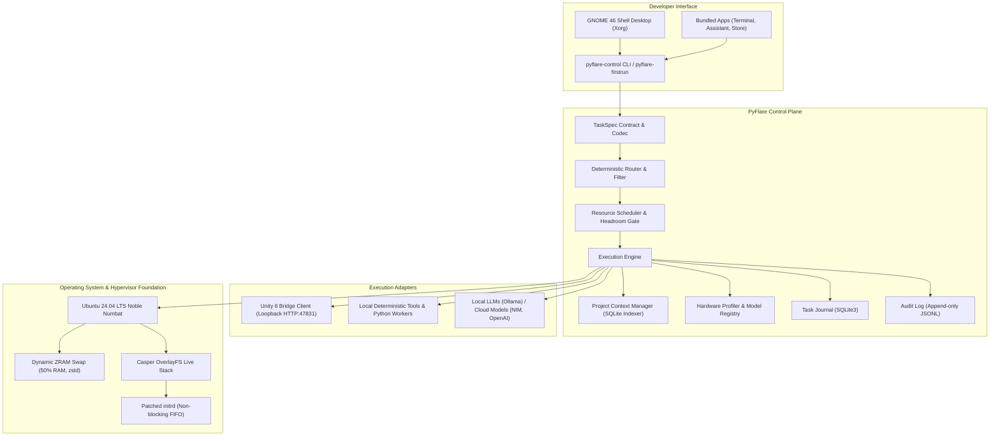
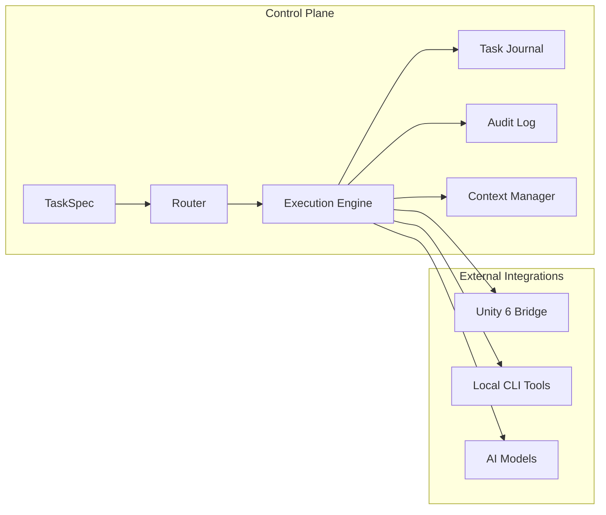

# PyFlare OS — Architecture & Systems Specification

**Version:** 1.0.0 (Ember Beta)  
**Status:** Beta Engineering Baseline  
**Author:** Aachman Studios  
**Last Updated:** 2026-11-01  
**Target Release:** 2 February 2027  

---

## Table of Contents

1. [Overview](#overview)
2. [High-Level Architecture](#high-level-architecture)
3. [Subsystem Breakdown](#subsystem-breakdown)
   - [Base System & Kernel Layer](#1-base-system--kernel-layer)
   - [Desktop Environment Layer (GNOME 46)](#2-desktop-environment-layer)
   - [PyFlare Control Plane Architecture](#3-pyflare-control-plane-architecture)
   - [Deterministic Routing & Policy Engine](#4-deterministic-routing--policy-engine)
   - [Execution Engine & Lifecycle Journal](#5-execution-engine--lifecycle-journal)
   - [Project Context Manager](#6-project-context-manager)
   - [Hardware-Aware Intelligence & Model Registry](#7-hardware-aware-intelligence--model-registry)
   - [Game Engine Integration (Unity 6 Editor Bridge)](#8-game-engine-integration-unity-6-editor-bridge)
   - [Branding System](#9-branding-system)
   - [Filesystem Overlay & Packaging](#10-filesystem-overlay--packaging)
   - [Installer Architecture (Calamares)](#11-installer-architecture)
4. [Component Dependency Graph](#component-dependency-graph)
5. [Data Flow](#data-flow)
6. [Design Principles](#design-principles)
7. [Release Management Artifacts](#release-management-artifacts)

---

## Overview

PyFlare OS is an AI-powered developer and game-development operating system built on an Ubuntu 24.04 LTS (Noble Numbat) foundation with GNOME 46. It is designed to adapt its capabilities to the host's physical or virtualized hardware constraints, managing local task execution, deterministic routing, project context, and native game engine automation.

The repository is structured with the canonical OS and control plane in `PyFlare/`:

| Sub-system | Path | Role |
|---|---|---|
| **Control Plane Core** | `PyFlare/control_plane/src/pyflare_control/` | Deterministic router, execution engine, context manager, hardware profiler, model registry, journal, and audit trail |
| **Unity Automation Bridge** | `PyFlare/integrations/unity/` | C# Unity package (`com.aachmanstudios.pyflare.automation`) providing authenticated loopback RPC for Unity 6 Editor |
| **Filesystem Overlay** | `PyFlare/filesystem/` | Root filesystem overlay with systemd services, GDM3/Xorg configs, dconf schemas, and user profile skeletons |
| **Remaster Pipeline** | `PyFlare/scripts/` | Fast ISO remastering, Casper initrd patching, and hybrid xorriso assembly |
| **Desktop Applications** | `PyFlare/applications/` | Bundled developer applications (AI Assistant, Store, Terminal, Settings, Files) |
| **Branding System** | `PyFlare/branding_generator/` | Procedural visual identity generator (GTK themes, icons, wallpapers, cursors, plymouth animations) |

---

## High-Level Architecture

---

## Subsystem Breakdown

### 1. Base System & Kernel Layer
- **Distribution:** Ubuntu 24.04.2 LTS (Noble Numbat).
- **Kernel:** `linux-generic-hwe-24.04` (6.8.0-100-generic).
- **Init System:** systemd 255.
- **Memory Architecture:** Dynamic ZRAM (`pyflare-zram.service`) creates a zstd compressed block device (`/dev/zram0`) sized to 50% physical RAM (capped at 4096 MB) with swapon priority 100. This eliminates out-of-memory kernel panics on 4 GB RAM VMs.
- **Initrd Patches:** `patch_initrd.py` injects non-blocking dummy `load_confmodule()` stubs into `scripts/casper-functions` and stubs out `scripts/casper-bottom/24preseed` / `22sslcert`, resolving infinite debconf spinlocks on uninitialized file descriptor 4.

### 2. Desktop Environment Layer
- **Shell:** GNOME Shell 46 with PyFlare-Dark theme.
- **Display Manager:** GDM3 with `WaylandEnable=false` and `AutomaticLogin=pyflare`.
- **Display Server:** Xorg (`gnome-xorg.desktop`), providing rock-solid rendering on VirtualBox VMSVGA and physical GPU adapters.
- **Theme Integrity:** `@import url("resource:///org/gnome/shell/theme/gnome-shell.css");` ensures all St/Clutter widgets inherit default styles without missing asset crashes.

### 3. PyFlare Control Plane Architecture
The control plane is implemented in Python 3.12+ as a modular library in `pyflare_control`:
- **`models.py`:** Strongly-typed dataclasses for `TaskSpec`, `ExecutionRequest`, `ExecutionResult`, `Capability`, `Provider`, and `ResourceBudget`.
- **`codec.py`:** Strict JSON serialization and deserialization enforcing schema constraints and disallowing unknown parameters.
- **`auth.py`:** Session manager handling user authentication, session expiration, and provider API key isolation.
- **`security.py`:** Path allowlist and denylist enforcement preventing tasks from escaping designated project roots.

### 4. Deterministic Routing & Policy Engine
Implemented in `pyflare_control.router`:
- **Hard Filters:** Enforces task permissions, privacy classes (`LOCAL_ONLY` strictly blocks cloud endpoints), offline states, and required applications.
- **Scoring Policy:** Deterministic local tools always outrank generative AI models for deterministic operations.
- **Circuit Breaker:** Tracks historical provider success rates and automatically routes around unavailable workers.

### 5. Execution Engine & Lifecycle Journal
Implemented in `pyflare_control.execution_engine`:
- **State Machine:** Persists execution states (`PENDING`, `ADMITTED`, `RUNNING`, `COMPLETED`, `FAILED`) in SQLite via `TaskJournal`.
- **Idempotency:** Replaying completed tasks returns cached execution results without re-executing side effects.
- **Audit Logging:** Emits structured JSON Lines events with secret redaction (API keys, bearer tokens, passwords masked).

### 6. Project Context Manager
Implemented in `pyflare_control.context`:
- Indexes project directory hierarchies into SQLite database (`context.sqlite3`).
- Tracks file contents, SHA-256 hashes, line counts, and AST symbols (functions, classes, Unity C# components).
- Automatically filters out node_modules, build artifacts, `.git`, and private credentials (`.env`, `*.pem`, `*.key`).

### 7. Hardware-Aware Intelligence & Model Registry
Implemented in `pyflare_control.hardware` and `model_registry`:
- Queries CPU cores, system RAM, GPU brand, and dedicated VRAM.
- Assigns systems to appropriate tiers: `API_ONLY`, `MINIMAL`, `BALANCED`, `CREATOR`, `STUDIO`.
- Verifies free disk storage before initiating local model weights downloads.
- Caches hardware profiles in memory with TTL to reduce query latency.

### 8. Game Engine Integration (Unity 6 Editor Bridge)
- **Editor Package:** `com.aachmanstudios.pyflare.automation` installed into Unity projects.
- **Bridge Server:** Lightweight HTTP loopback daemon listening on `127.0.0.1:47831`.
- **Security:** Requires high-entropy shared secret token passed in `Authorization: Bearer <token>`.
- **Reversibility:** Executes commands inside Unity Undo groups (`Undo.IncrementCurrentGroup()`), allowing game developers to instantly roll back AI modifications in the editor.

---

## Component Dependency Graph

---

## Release Management Artifacts

The following documents govern the delivery of PyFlare Beta 1.0 (2 February 2027):

1. [BETA_ROADMAP.md](BETA_ROADMAP.md) — Phased milestone schedule and deliverables.
2. [BETA_STATUS.md](BETA_STATUS.md) — Authoritative engineering status and release gate audit.
3. [BETA_ACCEPTANCE_CRITERIA.md](BETA_ACCEPTANCE_CRITERIA.md) — Acceptance criteria for all 7 release gates.
4. [BETA_TEST_MATRIX.md](BETA_TEST_MATRIX.md) — Test suites, hardware tiers, and automated inventory.
5. [BETA_RELEASE_CHECKLIST.md](BETA_RELEASE_CHECKLIST.md) — Pre-release verification gates.
6. [BETA_CHANGELOG.md](BETA_CHANGELOG.md) — Detailed version and sprint history.
7. [BETA_ISSUES.md](BETA_ISSUES.md) — Actionable engineering issues backlog.
